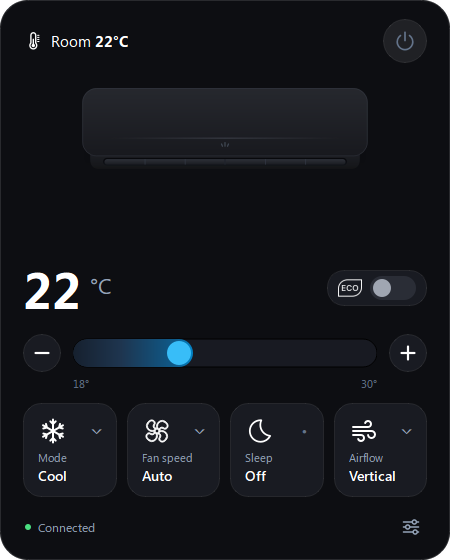
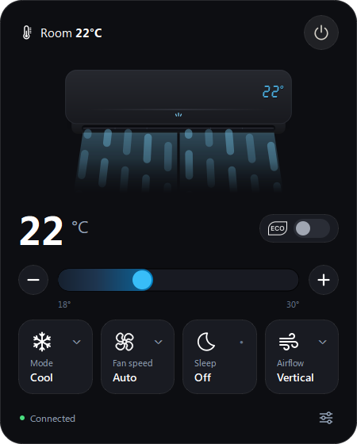
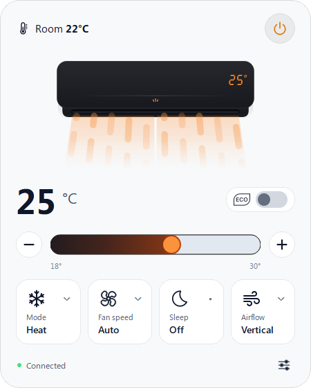
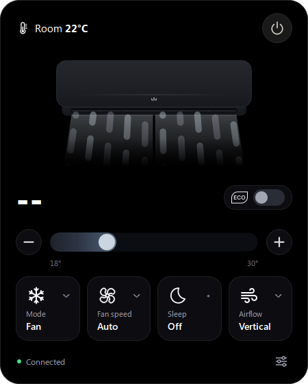

# WTC LG (Windows Tray Controller LG) - Controle seu AC do Windows

Aplicativo moderno para a bandeja do sistema (System Tray) do Windows 11/10 para controle em tempo real do ar-condicionado **LG Dual Inverter Voice** via nuvem **LG ThinQ API**.

Desenvolvido em **Python 3.11+** com **PySide6 (Qt)**, inspirado nas diretrizes visuais do macOS e flyouts modernos do Windows 11 (Dark Glass, Glassmorphism e micro-animações a 60 FPS).

<div align="center">
  <table>
    <tr>
      <td align="center"></td>
      <td align="center"></td>
    </tr>
    <tr>
      <td align="center"></td>
      <td align="center"></td>
    </tr>
  </table>
</div>

---

## Recursos e Destaques

- **Flyout Inteligente na Bandeja:** Posicionamento automático próximo ao relógio/área de notificação com auto-ocultação ao perder foco.
- **Sincronização Bidirecional em Tempo Real:** Consulta assíncrona do status real do aparelho na nuvem LG ThinQ sem travar a interface gráfica.
- **Temas Dinâmicos e Adaptação ao Windows:** Suporte completo aos modos **Escuro (Dark Glass)**, **Preto Puro (Black OLED)** e **Claro (Light)** com detecção e sincronização automática com o tema do Windows 11.
- **Hero Split Animado:** Cortina de vento volumétrica e suave (Option A) que se expande, ondula e curva suavemente em direção a $+X$, acompanhando o estado de energia do aparelho.
- **Cores Dinâmicas por Modo de Operação:**
  - **Cool:** Cortina azul ciano suave
  - **Heat:** Cortina em tom quente suave
  - **Fan:** Cortina cinza neutro
  - **Dry:** Cortina verde menta suave
- **Controle de Temperatura de Alta Precisão:**
  - Steppers vetoriais centralizados `(+)` e `(−)` com limites seguros (18°C a 30°C).
  - Slider customizado com trilha contínua em gradiente e efeito de arrasto fluido com debounce inteligente (400ms).
- **Cards Interativos:**
  - **Mode:** Seleção rápida entre Cool, Heat, Fan e Dry.
  - **Fan Speed:** Rotação horária suave do ícone ao passar o mouse ou quando selecionado.
  - **Sleep:** Temporizadores rápidos (1h, 2h, 4h, 8h ou Off).
  - **Airflow:** Controle de oscilação contínua (*Swing*) e aleta fixa (*Vertical*) com animação fluida.
- **Modo Eco:** Interruptor animado para desligar ou ligar a luz do visor do ar-condicionado.
- **Inicialização Automática com o Windows:** Opção com caixa de seleção integrada diretamente no menu da bandeja ("Iniciar com o Windows"), iniciando de forma silenciosa e minimizada em segundo plano no boot do sistema via Registro do Windows (HKCU, sem exigir permissão de Administrador).

---

## Como Usar (Instalação Rápida)

Você **não** precisa instalar Python, clonar repositório ou configurar arquivos de texto complexos. O aplicativo é 100% portátil.

### Passo a Passo:

1. **Baixe o Aplicativo Portátil:**
   - Acesse a aba **[Releases](../../releases)** do repositório no GitHub.
   - Baixe a versão mais recente do arquivo executável: **`WTC LG.exe`**.
   - Coloque-o em qualquer pasta de sua preferência (ex: em `Documentos` ou `Arquivos de Programas`).

2. **Obtenha seu Token PAT (LG ThinQ Connect):**
   - Acesse o portal oficial da LG: 👉 **[connect-pat.lgthinq.com/login](https://connect-pat.lgthinq.com/login)**
   - Faça login com a **mesma conta LG ThinQ** na qual o seu ar-condicionado está vinculado.
   - Crie um novo **Personal Access Token (PAT)** ou copie o token já existente.

3. **Inicie e Cole no App:**
   - Dê um duplo clique no **`WTC LG.exe`**.
   - O aplicativo se abrirá solicitando o token (ou clique no ícone da bandeja junto ao relógio do Windows).
   - Cole o token no campo **Personal Access Token (PAT)** e clique em **Salvar e Conectar**.
   - O assistente validará a conexão em tempo real, descobrirá o seu ar-condicionado e pronto!

> [!NOTE]
> Suas credenciais são salvas com segurança de nível bancário no cofre local da **Windows DPAPI** (`%APPDATA%/LG-DualInverter-Controller`), criptografadas com a chave do seu próprio usuário do Windows.
>
> Você também pode ativar a opção **"Iniciar com o Windows"** com 1 clique direto no menu de contexto da bandeja (botão direito no ícone).

---

## Para Desenvolvedores (Execução via Código Fonte)

Caso deseje contribuir ou rodar a partir do código fonte em Python:

1. **Ambiente e Dependências:**
   ```bash
   python -m venv venv
   venv\Scripts\activate
   pip install -r requirements.txt
   ```

2. **Executar em modo desenvolvimento:**
   ```bash
   python ui_panel.py
   ```

3. **Compilar o Executável Portátil (.exe) com PyInstaller:**
   ```bash
   pip install pyinstaller
   pyinstaller --noconsole --onefile --windowed --add-data "assets;assets" --icon="assets/app_icon.ico" --name "WTC LG" ui_panel.py
   ```
   O arquivo final será gerado em `dist/WTC LG.exe`.

---

## Estrutura do Projeto

```text
├── assets/                 # Ícones vetoriais SVG, assets gráficos e frames
├── scratch/                # Scripts de testes unitários e validações visuais
├── .env.example            # Template de variáveis de ambiente seguras
├── .gitignore              # Regras de exclusão para Git
├── requirements.txt        # Dependências do projeto
├── test_connection.py      # Diagnóstico e descoberta de dispositivos LG
├── test_control.py         # Teste interativo via terminal
└── ui_panel.py             # Aplicativo principal (GUI PySide6 + LG ThinQ)
```

---

## Licença

Projeto desenvolvido para fins de estudo e automação residencial pessoal.
